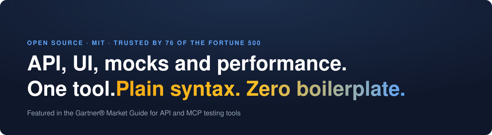
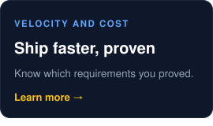
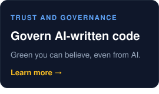
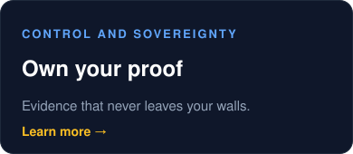
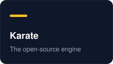
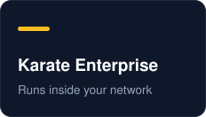
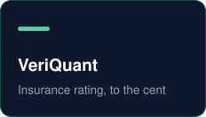

<p align="center">
  <a href="https://karatelabs.io">
    <picture>
      <source media="(prefers-color-scheme: dark)"
        srcset="https://raw.githubusercontent.com/karatelabs/.github/main/profile/karate-labs-wide-black.png">
      
    </picture>
  </a>
</p>

<p align="center">
  <a href="https://karatelabs.io"></a>
</p>

<p align="center">
  <a href="https://github.com/karatelabs/karate"></a>
  <a href="https://github.com/karatelabs/karate/releases"></a>
  <a href="https://github.com/karatelabs/karate/blob/main/LICENSE"></a>
  <a href="https://marketplace.visualstudio.com/items?itemName=karatelabs.karate"></a>
  <a href="https://plugins.jetbrains.com/plugin/19232-karate"></a>
  <a href="https://docs.karatelabs.io"></a>
</p>

### A whole API test. No code, no step definitions.

```gherkin
Feature: users API

  Scenario: create and fetch a user
    Given url baseUrl + '/users'
    And request { name: 'Ana', email: 'ana@example.com' }
    When method post
    Then status 201
    And match response == { id: '#number', name: 'Ana', email: '#string' }
```

API, UI, mocks and performance tests share one syntax, run in parallel, and produce a report your whole team can read.

<a href="https://docs.karatelabs.io"></a>

<a href="https://www.youtube.com/watch?v=WfVGuPURVK8"></a>

### When AI writes the code and the tests

Generation got cheap. Knowing what's safe to ship didn't. Karate governs it, on the same open-source engine.

<p align="center">
  <a href="https://karatelabs.io/velocity"></a>
  <a href="https://karatelabs.io/trust-governance"></a>
  <a href="https://karatelabs.io/control"></a>
</p>

### We publish our own failing grade

Our reference API, graded by our own tooling, in public, on every commit. No login, no demo request.

**The graded spec**<br>
<a href="https://karatelabs.github.io/karate-agent-examples/policy-api/ext/governance/pages/governance.html"></a>
<a href="https://karatelabs.github.io/karate-agent-examples/policy-api/ext/governance/pages/governance.html"></a>
<a href="https://karatelabs.github.io/karate-agent-examples/policy-api/ext/governance/pages/governance.html"></a>
<a href="https://karatelabs.github.io/karate-agent-examples/policy-api/ext/governance/pages/governance.html"></a>

**The paired run**<br>
<a href="https://karatelabs.github.io/karate-agent-examples/policy-api/ext/contract/pages/contract.html"></a>
<a href="https://karatelabs.github.io/karate-agent-examples/policy-api/ext/contract/pages/contract.html"></a>
<a href="https://karatelabs.github.io/karate-agent-examples/policy-api/ext/contract/pages/contract.html"></a>

[Open the governance report](https://karatelabs.github.io/karate-agent-examples/policy-api/ext/governance/pages/governance.html) · [Open the contract report](https://karatelabs.github.io/karate-agent-examples/policy-api/ext/contract/pages/contract.html) · [How it is computed](https://karatelabs.io/api-governance)

### The Karate Labs family

<p align="center">
  <a href="https://github.com/karatelabs/karate"></a>
  <a href="https://karatelabs.io/agent"></a>
  <a href="https://karatelabs.io/xplorer"></a>
  <a href="https://karatelabs.io/karate-enterprise"></a>
  <a href="https://veriquant.io"></a>
</p>

> "Guidewire decided to leverage Karate Labs for our Testing Framework: a powerful, open-source, industry-standard technology designed to make testing automation simple and accessible."<br>
> Will Murphy, VP, Global Technology Alliances, Guidewire

---

<p align="center">
  <a href="https://docs.karatelabs.io">Docs</a> · <a href="https://docs.karatelabs.io/getting-started/quick-start">Get started</a> · <a href="https://karatelabs.io/learning">Learning</a> · <a href="https://karatelabs.io/karate-enterprise">Enterprise</a> · <a href="https://karatelabs.io/customers">Customers</a> · <a href="https://karatelabs.io/contact-us">Contact</a><br>
  <a href="https://www.linkedin.com/company/karatelabs">LinkedIn</a> · <a href="https://x.com/getkarate">X</a> · <a href="https://www.youtube.com/@karatelabs">YouTube</a>
</p>
